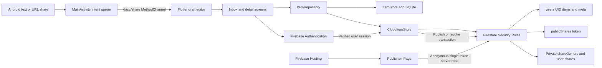

# KLASC Architecture and Data Model

## Component diagram

Local storage and the cloud repository are alternative libraries, not a synchronization pair. Firebase Authentication supplies identity; Firestore Security Rules decide whether each read or write is allowed. The rules apply even when a caller bypasses Flutter and uses the Firebase SDK directly.

## Storage model

| Location | Contents | Access |
| --- | --- | --- |
| Native `klasc.db`, table `items` | Integer ID, type, title, content, tags JSON, timestamps, archived flag, image bytes | Device app storage; independent of accounts |
| Browser local SQLite adapter | Equivalent local item model backed by IndexedDB | Browser profile and origin |
| `users/{uid}/items/{id}` | Item model plus `ownerId`, server timestamps, nullable base64 `imageData` | Matching authenticated UID only |
| `users/{uid}/meta/sequence` | `nextId` integer | Matching authenticated UID only |
| `users/{uid}/shares/{id}` | Token of the current public snapshot | Owner get/create/delete; no public access |
| `shareOwners/{token}` | `ownerId`, `itemId`, `sourceCreated` | Private owner metadata; also consulted internally by rules |
| `publicShares/{token}` | `type`, `title`, `content`, `imageData`, `sharedAt` | Anonymous get of a valid token; no collection listing or visitor writes |

IDs are positive integers, such as `1` and `2`, scoped to each library/account. Local IDs use SQLite autoincrement. Cloud IDs use a sequence and item write in the same transaction. The public token is deliberately different: 32 random bytes encoded into a 64-character hexadecimal string.

## Public link lifecycle

1. The authenticated owner selects Create public link for an existing cloud item.
2. A transaction creates the sanitized snapshot and both private ownership mappings. Rules verify the snapshot equals the allowed source fields.
3. The shared URL is `https://klasc-8d959.web.app/s/<token>`; it contains no UID or item number.
4. The hosted viewer makes a single-document server request. Rules check the live mappings and the source creation timestamp before allowing it.
5. Revocation removes the snapshot and mappings. Deleting a source through KLASC removes them in the same transaction. Missing source documents also cause rules to deny the public read.
6. The viewer shows an unavailable state for deleted, revoked, or malformed links. Source edits do not change an existing snapshot; revoke and republish for updated content.

The viewer disables Firestore disk persistence and periodically rechecks valid links. Firebase Hosting sets no-store, no-referrer, and noindex headers for public-share routes. These measures reduce stale presentation and accidental disclosure; recipients can still retain content they have already read.
