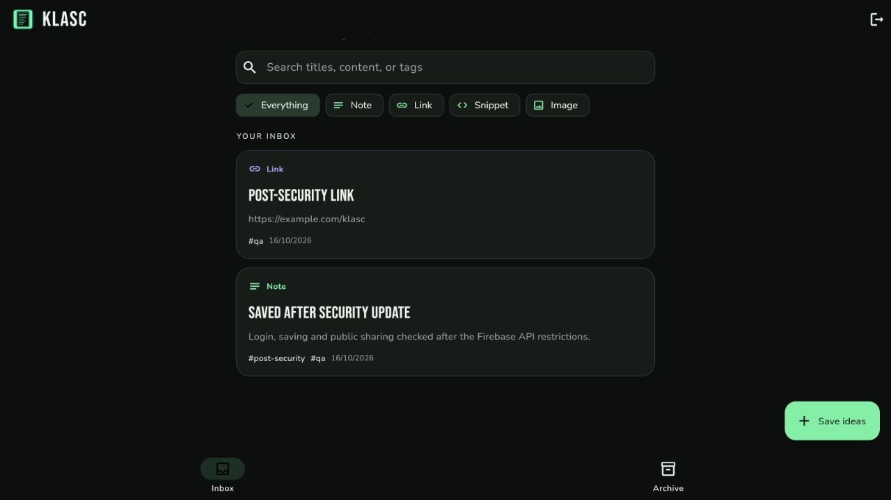
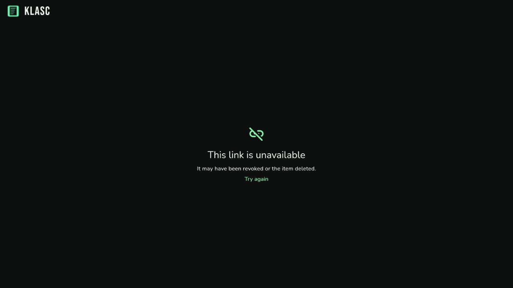

# KLASC Post Security Verification

Date: October 16, 2026. Tested after both Firebase client keys were narrowed to six Firebase APIs. No application code, APK bytes, or security rules changed during this verification.

## Deployed web UI

The live app at https://klasc-8d959.web.app/ was exercised in the Codex in-app browser using an isolated synthetic account. Chrome was also attempted, but its automation connection repeatedly timed out or disconnected; a complete Chrome pass is not claimed for this run.

| Flow | Result |
| --- | --- |
| Existing-account login | Passed; private inbox opened |
| Wrong password | Passed; clear incorrect-credentials feedback |
| Save a note with tags | Passed; saved title, content, and tags appeared in the inbox and were read back from Firestore |
| Search by tag | Passed |
| Save an HTTP/HTTPS link | Passed; appeared alongside the note |
| Reload persistence | Passed; both saved items returned |
| Sign out and sign back in | Passed; private view cleared on sign-out and both items returned after correct login |
| Owner creates a public link | Passed through the item detail dialog; snapshot and mapping were verified in Firestore |
| Hosted public viewer | Passed; displayed the selected title and content without inbox/profile/tag controls |
| Owner revokes the link | Passed through the UI; reloading the former URL displayed “This link is unavailable” |
| Copy link clipboard | Not confirmed; the in-app browser's clipboard read returned no text. The stored token and hosted URL were independently verified |
| Initial signup attempt | Returned a connection error in the browser, although a synthetic account existed server-side afterward. It was removed. This run does not certify successful signup completion through that browser |

The browser encountered intermittent connection and automation errors. Existing-account login and the saving/sharing flows later completed successfully. Those recoveries do not turn the initial signup or clipboard checks into passes.





## APK and cloud compatibility

The downloadable APK was inspected directly. It remains version 3.1.0, version code 5, package `com.klasc.klasc`, minimum Android API 24. Its Firebase configuration matches the current source, the deployed web configuration, and the reviewed keys. Its branding asset matches the supplied symbol. Its manifest still registers `ACTION_SEND` with `text/plain` and a singleTop launch activity.

APK SHA-256:

```text
EFE0C3D7D1101256AF2A8B7EA5CFDAB91A753858C043841202CB56702CD4F2FF
```

Using the configuration extracted from that APK, fresh live client-SDK checks passed with both the Web and Android keys: sign-up/sign-in, incorrect-password rejection, owner reads from a second client, note/link/snippet/image saving, editing, archive/restore, direct cross-account and anonymous private-read denials, sanitized public snapshots, snapshot stability after source edits, and revocation. See [the live results](evidence/post-security-live-check.txt).

These are API/client-SDK compatibility checks, not a native Android runtime pass. `adb devices` showed no connected phone, and the emulator reported that its hypervisor driver was unavailable. Login/save/share UI on the installed APK, native clipboard behavior, and the physical Chrome Share-menu flow therefore remain unverified in this run.

## Regression and cleanup

All 24 Flutter regression tests passed again, including local saving/persistence, forms, share parsing/queueing and draft behavior, public-viewer failure/revocation states, and stale-response guards.

The browser was signed out before cleanup. Synthetic UI and public-viewer accounts, items, and sharing documents were removed, including the account left by the failed initial signup attempt. Temporary credential fixtures were removed. Private sequence metadata remains under deleted synthetic UIDs, as with the earlier test records; it is inaccessible to other users under the ownership rules.

No security-restriction regression was found in the flows that passed. Native runtime, initial browser signup completion, and clipboard integration are the outstanding limits above.
