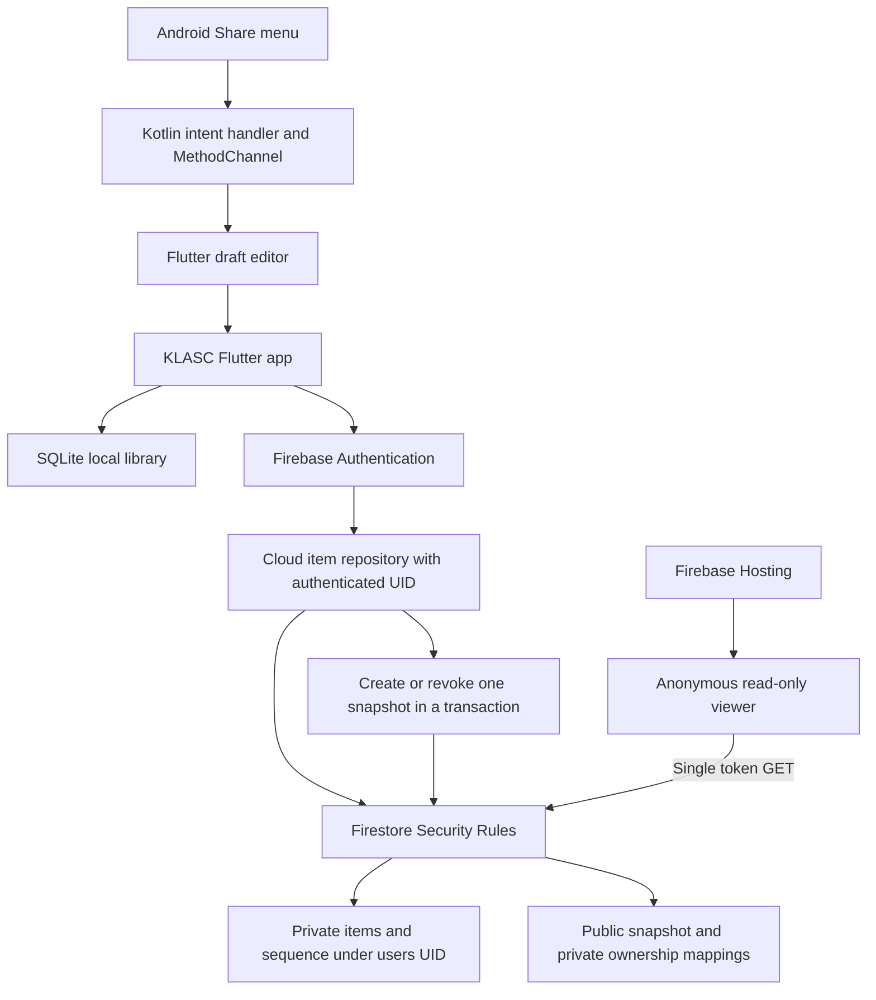

# KLASC Class Project Report

**Project:** KLASC personal save-for-later app

**Author:** Aditya Pandey

**Submission date:** October 16, 2026

**Build:** 3.1.0, Android version code 5

**Repository:** [Aditya24123/klasc_apk](https://github.com/Aditya24123/klasc_apk)

## Purpose and scope

KLASC keeps useful notes, article links, code snippets, and images in one searchable inbox. A saved item can be tagged, edited, archived, restored, or deleted. The project starts with a reliable single-device library and adds private account storage and selective sharing.

The submitted implementation reaches Stage 3. Local saving and private cloud storage have automated coverage; live cloud and browser sharing flows were also checked. Android Share-menu intake is implemented and its parsing, queue, and draft flow have automated tests, but the complete Chrome-to-KLASC flow still needs verification on a physical Android phone. This is a classroom build with that testing limit, rather than a claim that every platform and device has been certified.

## Deliverables

| Requirement | KLASC submission |
| --- | --- |
| Source repository | Flutter app, native Android share bridge, Firebase rules, dependency lockfiles, and tests in this repository |
| Commit history | Real import and submission commits dated when created; earlier local work is documented in [DEVELOPMENT.md](DEVELOPMENT.md) |
| Runnable build | [KLASC 3.1 Android APK](https://drive.google.com/file/d/1t_LWcLUB3eImIw_qB8Wkr7on1zJxGFwD/view?usp=drivesdk) and [hosted browser app](https://klasc-8d959.web.app/) |
| Short README | [README.md](../README.md) covers features, stage, stack, running, decisions, and limits |
| Authentication and privacy | Explained below, with backend authorization in [firestore.rules](../firestore.rules) |
| Architecture | Diagram and storage model in [ARCHITECTURE.md](ARCHITECTURE.md) |
| Verification | Test coverage, evidence, reproduction commands, and remaining checks in [TESTING.md](TESTING.md) |

## Implemented features

**Stage 1 — local app.** The inbox supports notes, HTTP/HTTPS links, snippets, and picked images. Every item has a simple integer ID, type, title, content or URL, tags, created and updated timestamps, and archived state. IDs remain internal to storage rather than cluttering the interface. SQLite persists native data across reopening; web local mode uses a SQLite/IndexedDB adapter. Users can create, open, edit, delete, search, filter by type, archive, and restore items. Tags are normalized and searchable. Forms reject missing required input and invalid URLs, and image loading has a fallback for corrupt data.

**Stage 2 — private cross-device inbox.** Firebase Authentication provides email/password accounts. Signing in with the same account on another client retrieves that account's Firestore items, including private images. The UI uses a custom display name and cartoon avatar. Loading, credential errors, failed cloud requests, and retry feedback are handled. Cloud saves use transactions; local mode remains available independently.

**Stage 3 — share into the app.** Android advertises an `ACTION_SEND` handler for `text/plain`. `MainActivity.kt` receives shared text and URLs, then passes them through the `klasc/share` MethodChannel. Pending shares are queued for app startup and for an already running app. A recognizable URL becomes a link draft; other text becomes a note draft. The user can change the title, add tags, and save explicitly. Sharing into KLASC does not silently save content. This intake currently covers text and URLs, not incoming image attachments or iOS Share extensions.

**Stage 3 — public read-only sharing.** A signed-in owner can create a public URL for one cloud item and later revoke it. The app generates a cryptographically random 32-byte token, encoded as 64 hexadecimal characters. The URL contains this token, not an account UID or the predictable item number. An anonymous viewer can read only that published snapshot. Deleted or revoked links display an unavailable state. Public links are bearer links: anyone who receives a valid link can read that snapshot.

The interface uses a dark background, mint and item-type accents, Bebas Neue headings, Nunito body text, and the supplied KLASC symbol. Inbox controls remain compact, with searchable tags on items and a clear “Save ideas” action.

## Architecture

The UI calls an `ItemRepository` interface. `ItemStore` implements local SQLite behavior; `CloudItemStore` implements Firestore behavior. This keeps item operations understandable while using the same screens in both modes. Firebase supplies authentication and the managed database; no custom application server or Admin SDK is required in the client.

## Authentication and privacy

Firebase Authentication creates accounts and verifies email/password credentials. A successful sign-in establishes a user session with a UID. Firebase SDK requests carry the authentication token; Firestore evaluates the verified identity through `request.auth`. The app does not store passwords in SQLite or item documents. The custom username is a display name; users sign in with email.

Cloud data is stored in project `klasc-8d959`, with the Firestore database in Delhi (`asia-south2`). Private documents use `users/{uid}/items/{itemId}` and contain `ownerId` as well as the item fields. The account's next simple ID is stored at `users/{uid}/meta/sequence`. Small image bytes are base64 encoded inside the owner's document, rather than exposed through public file-download URLs. Local-only data stays in the device's app database or browser storage.

The backend rule `owns(uid)` requires an authenticated request whose UID equals the owner path. Creation and updates also validate `ownerId`, ID, field shape, item type, sizes, and timestamps; updates cannot replace the original owner or creation date. Other paths default to denied. Account B therefore cannot read, list, edit, archive, delete, or overwrite Account A's items by guessing an ID or bypassing the UI. Client-side filtering is not the privacy boundary. The [security tests](../backend/security.test.mjs) make direct requests as separate authenticated and anonymous clients.

A public snapshot contains only `type`, `title`, `content`, `imageData`, and `sharedAt`. It excludes the inbox, account details, tags, and internal item IDs. Private mappings associate the token with its owner and source item. Rules permit a single-token read only while those mappings are valid and the original source creation timestamp still matches. Anonymous collection listing and visitor writes are denied. Reusing a deleted item's ID cannot revive its former link.

Revoke deletes the snapshot and mappings transactionally; app deletion of a shared source also removes them. The viewer fetches from the server and rechecks an available link every 30 seconds. Revocation denies subsequent reads, although an already open view can remain visible until its next check. Revocation cannot erase screenshots or content a recipient already copied. Backend authorization protects users from one another; the project does not implement end-to-end encryption against Firebase administrators.

## Important decisions

| Decision | Reason and tradeoff |
| --- | --- |
| Separate local and cloud libraries | Clear storage behavior and a useful local app; there is no automatic upload or migration of local items |
| Simple per-account integer IDs | Easy to explain and maintain; ownership rules, rather than ID secrecy, protect private items |
| Transactional cloud mutations | The ID counter and item commit together; source deletion and share cleanup remain consistent |
| Server-confirmed cloud operations | Request failures are visible and retriable; there is no background offline sync queue |
| Private images in Firestore | One ownership boundary and no Storage download tokens; cloud images are limited to 512 KiB, local images to 10 MiB |
| Public snapshots instead of private-item access | Explicitly limits public fields; later source edits require revoke and republish to update the shared content |
| Development signing for the classroom APK | Practical installation and compatible updates from the same key; production distribution needs a dedicated release key |

The app limits titles to 120 characters and cloud content to 50,000 characters. The cloud client normalizes up to 20 tags, each at most 40 characters; rules independently enforce the allowed field structure and tag-list count. Search currently loads the owner's items and filters on the client, which suits a small personal library but is not designed for a large indexed collection.

## Verification and remaining work

The recorded verification includes **24 passing Flutter tests**, **12 passing Firestore emulator tests**, clean Flutter analysis, successful APK/web builds, live account-isolation checks, and interactive Chrome checks. The browser pass verified invalid-password feedback, sign-in, profile update, creating and tagging a note, search, editing, archiving/restoring, persistence after signing out and back in, anonymous public viewing, and owner revocation. The imported repository also passed a fresh Flutter analysis and all 24 Flutter tests on October 16. Evidence and precise scope are in [TESTING.md](TESTING.md).

Previous debugging fixed stale asynchronous loads replacing newer data, listeners attaching after a screen was disposed, malformed image data crashing views, shared text truncation, pending-share loss, and public-link timeout/retry behavior. Tests exercise those regressions. Passing these checks does not establish that the app has no bugs.

The most important next check is installing the APK on a physical phone and sharing a Chrome article into KLASC while the app is both closed and open. Browser signup UI, file-image upload, and permanent-delete UI were not exercised in the recorded Chrome pass. Automated widget checks cover small screens and larger text, but narrow-screen Chrome testing was not completed. iOS project files are present as scaffolding; no iOS build or share extension is claimed. Cloud use depends on connectivity and the configured Firebase project's availability and quotas.

## Code explanation guide

| File | What to explain during review |
| --- | --- |
| `lib/store.dart` | Item model, normalized tags, URL validation, repository interface, and SQLite CRUD |
| `lib/main.dart` | Inbox, editor, item details, search, archive, and guarded asynchronous loading |
| `lib/cloud_gate.dart` | Firebase initialization, emulator selection, authentication gate, and session changes |
| `lib/cloud_store.dart` | UID-scoped paths, transactions, image limits, and public-share creation/revocation |
| `lib/share_intake.dart` and `MainActivity.kt` | Platform bridge, queued shared payloads, URL parsing, and editable drafts |
| `lib/public_share.dart` | Token-only viewer, unavailable state, network retry, and periodic revocation checks |
| `firestore.rules` and `backend/security.test.mjs` | Server authorization and direct cross-account attack tests |

Libraries, Firebase services, documentation, and AI coding assistance were used during development. Firebase's SDK handles identity and networking; SQLite handles local persistence; Flutter widgets compose the UI. The project-specific code connects those components, defines item behavior, implements share intake, and specifies and tests the authorization policy. The architecture and these files are the basis for explaining the implementation.
