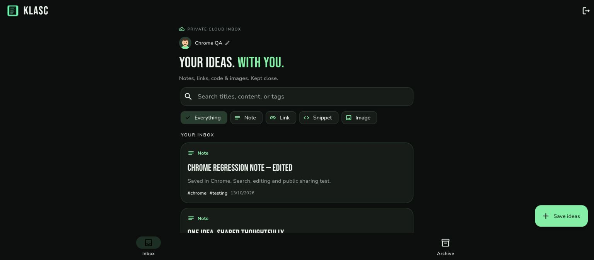
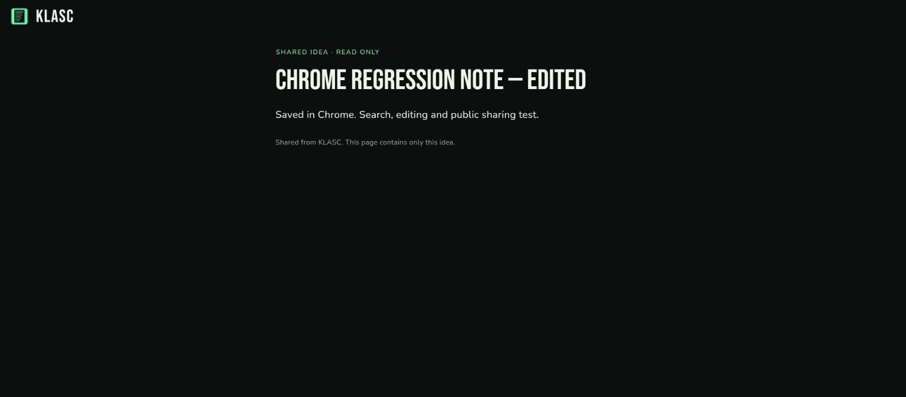
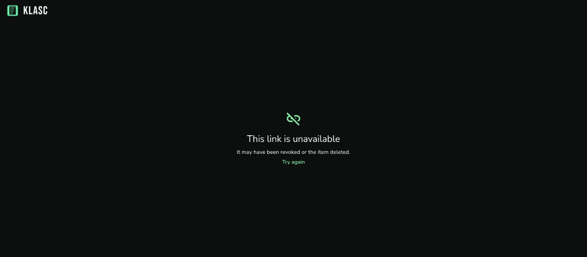

# KLASC Testing and Evidence

## Recorded verification

These are recorded results from the KLASC 3.1 development and Chrome verification passes on October 13, 2026. The class submission was assembled on October 16. A recording of passing tests is evidence of the exercised behavior, not a guarantee that every possible bug is absent.

| Check | Recorded result | Scope |
| --- | --- | --- |
| Flutter analysis | No issues | Dart analysis |
| Flutter unit/widget tests | 24 passed | CRUD, persistence, validation, small layouts, profiles, share intake, viewer errors, and asynchronous races |
| Firestore emulator security tests | 12 passed | Direct ownership, public-read restrictions, forged writes, revocation, and deleted-source protection |
| Live client SDK checks | Passed | Email/password, second-client account data, direct Account B denials, images, network failure/retry, owner deletion |
| Chrome interactive checks | Passed for exercised flows | Sign-in, profile, note/tag creation, search, edit, archive/restore, reload, anonymous sharing, owner revoke |
| Android and web builds | Succeeded | Optimized APK and hosted web build; native package, signature, and supplied symbol checked |
| Native Android end-to-end share intake | Pending | No connected phone; Android emulator could not run with the available hypervisor configuration |

Recorded text evidence:

- [Chrome verification record](evidence/chrome-test-report.txt)
- [Live backend isolation results](evidence/live-security.txt)
- [Debug and build record](evidence/debug-report.txt), whose browser limitation was superseded by the separate successful Chrome pass

## Submission recheck on October 16

The imported repository passed a fresh dependency resolution, Flutter analysis with no issues, and all 24 Flutter tests. The 13 production Dart files and Firestore rules matched the original 3.1 source. The submitted APK checksum matched the value in SETUP.md; local documentation links and screenshot paths resolved, and the portable Windows helper passed a PowerShell syntax check. Backend/emulator and Chrome results above remain the recorded October 13 results; those live checks were not repeated during documentation assembly.

## Screenshots from the Chrome pass

These screenshots use synthetic test content. Their test accounts and shared documents were removed afterward; they are not working public-link examples.







## Reproduce automated checks

From the repository root, with Flutter available:

```sh
flutter pub get
flutter analyze
flutter test
```

The source is in `test/`. `store_test.dart` verifies saving, searching, updating, archiving/restoring, deleting, images, and reopening a SQLite database. Widget tests exercise form behavior, small-screen/large-text layouts, profile validation/retry, incoming-share drafts and queueing, corrupt images, public-link errors/revocation, and stale-response guards.

For backend authorization, use Node.js and JDK 21, then run:

```sh
npm ci --prefix backend
./backend/node_modules/.bin/firebase emulators:exec --only firestore,auth --project demo-klasc "node --test --test-concurrency=1 backend/security.test.mjs"
```

On Windows, use `./backend/node_modules/.bin/firebase.cmd`. The test harness uses only the demo emulator project and clears emulator data between cases. The tests authenticate independent A/B identities and issue direct SDK requests, including requests to Account A's paths while authenticated as B. Public tests cover allowed anonymous single-document reads, denied listing, denied visitor mutation, strict snapshot fields, invalid ownership, revocation, and source deletion/ID recreation.

A device integration test is also included:

```sh
flutter test integration_test/app_test.dart -d <android-device-id>
```

It exercises local CRUD and reopening a dedicated `klasc_device_test.db`, separate from the ordinary library. Its native runtime pass is not claimed in the recorded results.

## Classroom demonstration

1. Open the APK or hosted app. In local mode, save a note and an HTTP/HTTPS link, add tags, search, edit, archive/restore, then close and reopen.
2. Create Account A and save a cloud note. Sign in as A on a second browser/device and confirm the same item appears. Use Account B separately to show its own library.
3. Run the emulator security suite to demonstrate that B is denied even when directly requesting A's exact item path. An empty B inbox alone is insufficient proof of authorization.
4. As A, create a public link to one synthetic item. Open it signed out. Confirm that the selected content is visible without account information, tags, or inbox controls.
5. Revoke the link, then reload it and confirm the unavailable state. Repeat with a different item by deleting its source.
6. On Android, share an article from Chrome → KLASC. Confirm the URL is prefilled, add a title/tags, and save. Repeat when KLASC is already open, when it is closed, and with plain text; cancel a draft to check that it is not automatically saved.

## Remaining testing limits

The recorded Chrome pass remained at 1536 × 673 pixels, so it does not establish narrow-screen browser behavior. Browser file-image upload, signup UI, and permanent-delete UI were not exercised in that pass; automated/backend coverage supports related validations and permissions. Native Share-menu behavior still needs the physical-device demonstration above. iOS is unbuilt and has no share extension. No performance/load test of a very large inbox is claimed.

Recorded cleanup removed synthetic test accounts, items, and public sharing documents. Private sequence metadata remained under deleted synthetic UIDs, as noted in the original records. No temporary test passwords or account fixtures are included in this repository.

## Security recheck after API restrictions

On October 16, live SDK checks passed with both the Web and Android client keys after narrowing their API scope. The checks cover authentication, ownership isolation, anonymous public snapshots, and revocation. See [the results](evidence/security-recheck-2026-10-16.txt) and [the verified allowlists](evidence/firebase-api-restrictions.json). This is not a physical-device Android runtime pass. The repository credential guard and its self-test also passed.

## Follow-up product checks

The [post-security verification](POST_SECURITY_CHECK.md) records the successful live web login, note/link saves, reload and sign-in persistence, hosted sharing and UI revocation checks. It also records the initial signup connection error, unconfirmed in-app browser clipboard, and unavailable native-device checks without treating them as passes.
